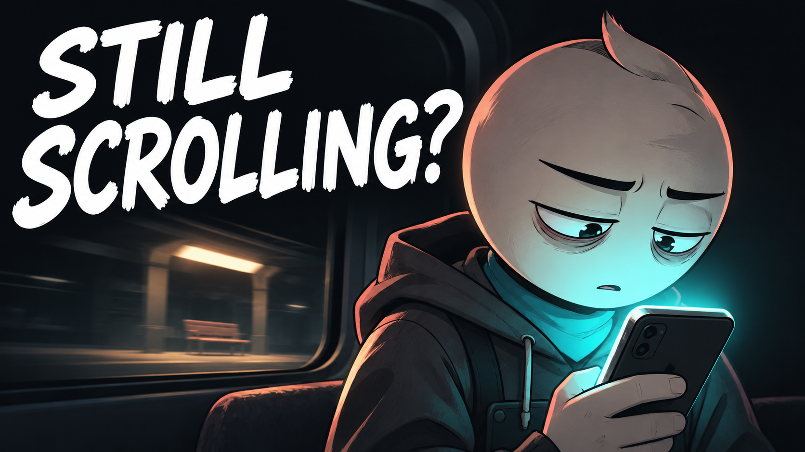

# 01 — Your Attention Is Being Sold

## Thumbnail



Texto na capa: **STILL SCROLLING?**

## Título — copiar

```text
Your Attention Is Being Sold | An Animated Short Film
```

## Descrição — copiar

```text
Eli missed his train stop with his phone in his hand. Noticing what else he was missing took longer.

Your Attention Is Being Sold is an original animated short film about phone distraction, endless scrolling, and being present for the people in front of us. A planned evening with a friend becomes a quiet test of how much attention a screen can take — and how deliberately we have to choose where it goes.

Which part of your day would you like to take back?

Subscribe to Hardstart Films for original animated stories about discipline, fear, habits, and becoming better.
https://www.youtube.com/@hardstartfilms

Credits
Original story, illustrations, music and sound design: Hardstart Films.
Synthetic narration: Piper / LibriTTS high.
LibriTTS dataset: Heiga Zen et al. (2019), CC BY 4.0.
https://www.openslr.org/60/
https://creativecommons.org/licenses/by/4.0/

#AnimatedShortFilm #DigitalDistraction #HardstartFilms
```

## Tags — copiar

```text
Your Attention Is Being Sold, phone distraction, digital distraction, endless scrolling, phone habits, screen time, attention economy, being present, digital wellbeing, self improvement animation, personal growth, animated short film, animated story, Hardstart Films
```
