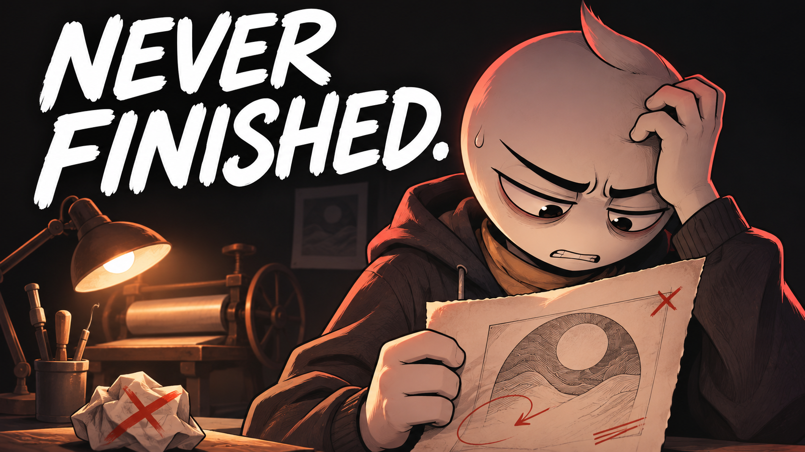

# 02 — The Draft You Never Finish

## Thumbnail



Texto na capa: **NEVER FINISHED.**

## Título — copiar

```text
The Draft You Never Finish | An Animated Short Film
```

## Descrição — copiar

```text
June can always imagine a better version of the print. Calling one finished is the part she cannot face.

The Draft You Never Finish is an original animated short film about perfectionism, creative doubt, and the fear of letting other people see your work. In a small printmaking studio, each revision promises relief while the unfinished pages keep piling up. The story follows the difficult choice between protecting an imagined perfect result and allowing a real piece of work to leave the desk.

What have you been afraid to call finished?

Subscribe to Hardstart Films for original animated stories about discipline, fear, habits, and becoming better.
https://www.youtube.com/@hardstartfilms

Credits
Original story, illustrations, music and sound design: Hardstart Films.
Synthetic narration: Piper / LibriTTS high.
LibriTTS dataset: Heiga Zen et al. (2019), CC BY 4.0.
https://www.openslr.org/60/
https://creativecommons.org/licenses/by/4.0/

#AnimatedShortFilm #Perfectionism #HardstartFilms
```

## Tags — copiar

```text
The Draft You Never Finish, perfectionism, creative perfectionism, fear of finishing, creative doubt, unfinished projects, finishing creative work, artist story, printmaking, creative confidence, personal growth animation, animated short film, animated story, Hardstart Films
```
