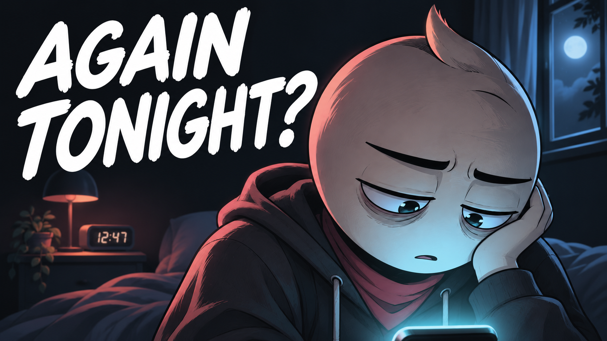

# 03 — The Promise After Midnight

## Thumbnail



Texto na capa: **AGAIN TONIGHT?**

## Título — copiar

```text
The Promise After Midnight | An Animated Short Film
```

## Descrição — copiar

```text
Every night, the promise sounds convincing. Every night, the screen stays on.

The Promise After Midnight is an original animated short film about late-night scrolling, instant relief, and the loneliness that can hide inside an ordinary routine. A familiar habit keeps offering a way to switch off uncomfortable feelings. A small return to drawing and human connection opens another possibility, one evening at a time.

What would a kinder evening routine look like for you?

Subscribe to Hardstart Films for original animated stories about discipline, fear, habits, and becoming better.
https://www.youtube.com/@hardstartfilms

Credits
Original story, illustrations, music and sound design: Hardstart Films.
Synthetic narration: Piper / LibriTTS high.
LibriTTS dataset: Heiga Zen et al. (2019), CC BY 4.0.
https://www.openslr.org/60/
https://creativecommons.org/licenses/by/4.0/

#AnimatedShortFilm #ChangingHabits #HardstartFilms
```

## Tags — copiar

```text
The Promise After Midnight, late night scrolling, instant gratification, instant relief, nighttime habits, phone habits, loneliness, changing habits, emotional escape, human connection, personal growth, animated short film, animated story, Hardstart Films
```
