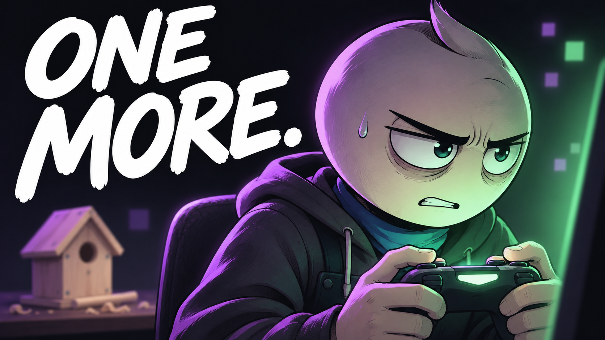

# 04 — One More Game

## Thumbnail



Texto na capa: **ONE MORE.**

## Título — copiar

```text
One More Game | An Animated Short Film
```

## Descrição — copiar

```text
One more match. One more evening. A promise to his brother keeps waiting.

One More Game is an original animated short film about gaming, escapism, and making room for the promises that matter outside the screen. A shared plan to build a birdhouse slowly disappears behind another round. The story explores what happens when enjoyable downtime starts taking the place of the life someone wanted to show up for.

What real-world promise do you want to make room for?

Subscribe to Hardstart Films for original animated stories about discipline, fear, habits, and becoming better.
https://www.youtube.com/@hardstartfilms

Credits
Original story, illustrations, music and sound design: Hardstart Films.
Synthetic narration: Piper / LibriTTS high.
LibriTTS dataset: Heiga Zen et al. (2019), CC BY 4.0.
https://www.openslr.org/60/
https://creativecommons.org/licenses/by/4.0/

#AnimatedShortFilm #GamingHabits #HardstartFilms
```

## Tags — copiar

```text
One More Game, gaming habits, gaming and life balance, one more match, escapism, screen time, keeping promises, family connection, gaming story, changing habits, personal growth animation, animated short film, animated story, Hardstart Films
```
