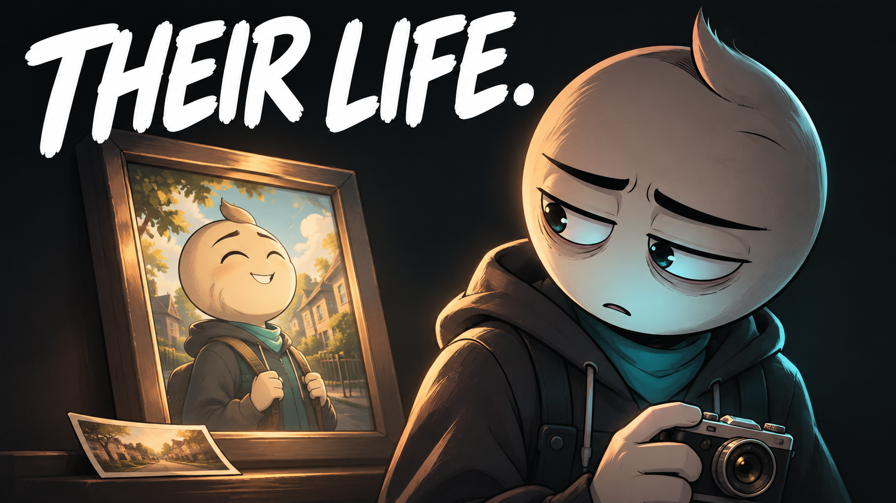

# 05 — Someone Else’s Life

## Thumbnail



Texto na capa: **THEIR LIFE.**

## Título — copiar

```text
Someone Else’s Life | An Animated Short Film
```

## Descrição — copiar

```text
He wanted to make something meaningful. Then he started measuring it against everyone else.

Someone Else's Life is an original animated short film about social comparison, creative confidence, and remembering why you started. A photographer sets out to make a book of neighborhood pictures for his grandmother. As other people's polished work becomes the standard, the personal reason behind his own project begins to disappear.

What would you make if someone else's work could not set the standard?

Subscribe to Hardstart Films for original animated stories about discipline, fear, habits, and becoming better.
https://www.youtube.com/@hardstartfilms

Credits
Original story, illustrations, music and sound design: Hardstart Films.
Synthetic narration: Piper / LibriTTS high.
LibriTTS dataset: Heiga Zen et al. (2019), CC BY 4.0.
https://www.openslr.org/60/
https://creativecommons.org/licenses/by/4.0/

#AnimatedShortFilm #SocialComparison #HardstartFilms
```

## Tags — copiar

```text
Someone Else's Life, social comparison, comparison trap, creative confidence, self worth, photography story, personal projects, finding your own path, creative purpose, personal growth, self improvement animation, animated short film, animated story, Hardstart Films
```
