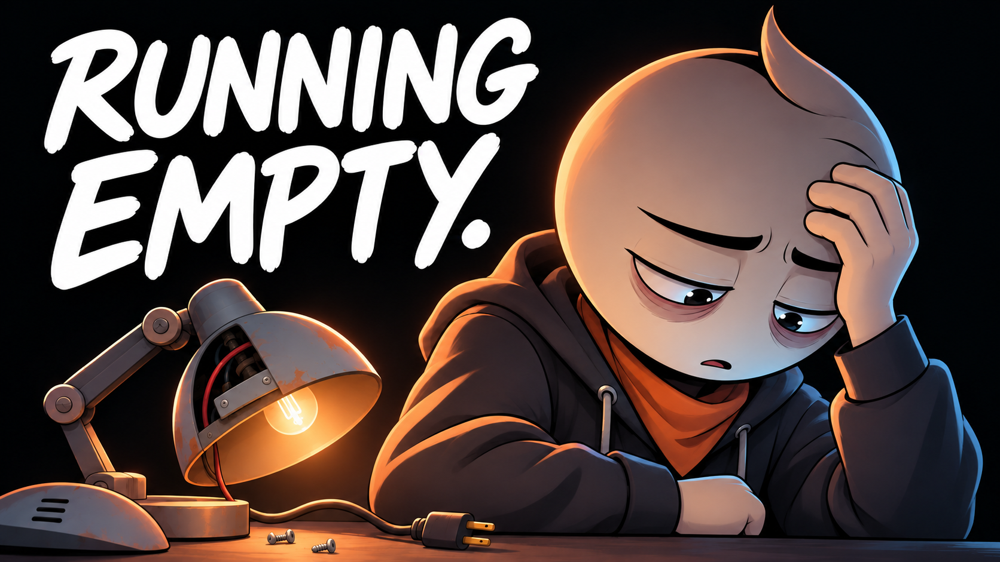

# 08 — You Can’t Outwork Empty

## Thumbnail



Texto na capa: **RUNNING EMPTY.**

## Título — copiar

```text
You Can’t Outwork Empty | An Animated Short Film
```

## Descrição — copiar

```text
He kept repairing lamps while ignoring his own exhaustion.

You Can't Outwork Empty is an original animated short film about burnout, the guilt of resting, and learning to recognize a limit. In a repair workshop, another task always seems more urgent than stopping. The story follows an exhausted worker as he begins to change the load he is carrying and accept support instead of treating every warning as a reason to push harder.

What would a realistic limit look like this week?

Subscribe to Hardstart Films for original animated stories about discipline, fear, habits, and becoming better.
https://www.youtube.com/@hardstartfilms

Credits
Original story, illustrations, music and sound design: Hardstart Films.
Synthetic narration: Piper / LibriTTS high.
LibriTTS dataset: Heiga Zen et al. (2019), CC BY 4.0.
https://www.openslr.org/60/
https://creativecommons.org/licenses/by/4.0/

#AnimatedShortFilm #Burnout #HardstartFilms
```

## Tags — copiar

```text
You Can't Outwork Empty, burnout story, exhaustion, rest guilt, work life balance, setting boundaries, asking for help, sustainable work, overwork, self care, personal growth, animated short film, animated story, Hardstart Films
```
