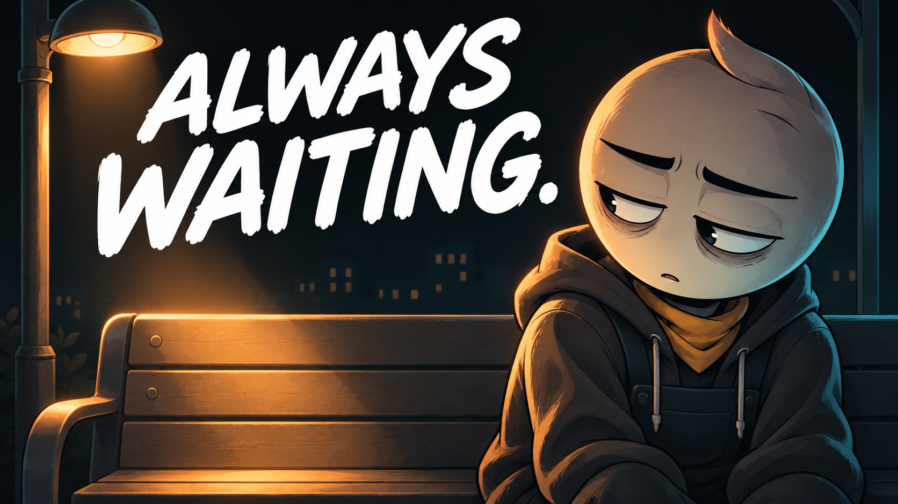

# 09 — The Empty Seat

## Thumbnail



Texto na capa: **ALWAYS WAITING.**

## Título — copiar

```text
The Empty Seat | An Animated Short Film
```

## Descrição — copiar

```text
He kept hoping someone would sit beside him. Reaching out felt harder than waiting.

The Empty Seat is an original animated short film about everyday loneliness, small acts of courage, and the slow work of building a connection. A familiar bus stop becomes a picture of everything left unsaid. Through an ordinary community workshop, the story explores how belonging can begin with initiative, patience, and showing up for other people too.

What is one small way you could reach out today?

Subscribe to Hardstart Films for original animated stories about discipline, fear, habits, and becoming better.
https://www.youtube.com/@hardstartfilms

Credits
Original story, illustrations, music and sound design: Hardstart Films.
Synthetic narration: Piper / LibriTTS high.
LibriTTS dataset: Heiga Zen et al. (2019), CC BY 4.0.
https://www.openslr.org/60/
https://creativecommons.org/licenses/by/4.0/

#AnimatedShortFilm #HumanConnection #HardstartFilms
```

## Tags — copiar

```text
The Empty Seat, loneliness, making friends, human connection, belonging, community, reaching out, everyday courage, social connection, friendship story, personal growth animation, animated short film, animated story, Hardstart Films
```
