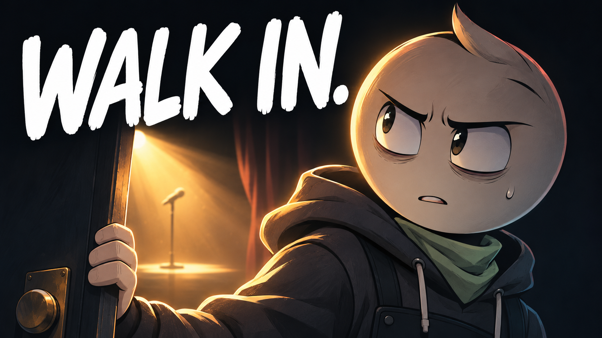

# 10 — The Door You Keep Avoiding

## Thumbnail



Texto na capa: **WALK IN.**

## Título — copiar

```text
The Door You Keep Avoiding | An Animated Short Film
```

## Descrição — copiar

```text
The hardest part of the performance happened before he reached the stage.

The Door You Keep Avoiding is an original animated short film about fear of judgment, stage fright, and letting people see something you have made. Outside a small performance space, a first-time performer has plenty of reasons to turn around. One open doorway holds the possibility of a mistake, an audience, and an experience he cannot get by remaining in the corridor.

What door have you been standing outside?

Subscribe to Hardstart Films for original animated stories about discipline, fear, habits, and becoming better.
https://www.youtube.com/@hardstartfilms

Credits
Original story, illustrations, music and sound design: Hardstart Films.
Synthetic narration: Piper / LibriTTS high.
LibriTTS dataset: Heiga Zen et al. (2019), CC BY 4.0.
https://www.openslr.org/60/
https://creativecommons.org/licenses/by/4.0/

#AnimatedShortFilm #CreativeCourage #HardstartFilms
```

## Tags — copiar

```text
The Door You Keep Avoiding, fear of judgment, stage fright, first performance, creative courage, self doubt, sharing your work, taking the first step, fear of failure, personal growth animation, animated short film, animated story, Hardstart Films
```
