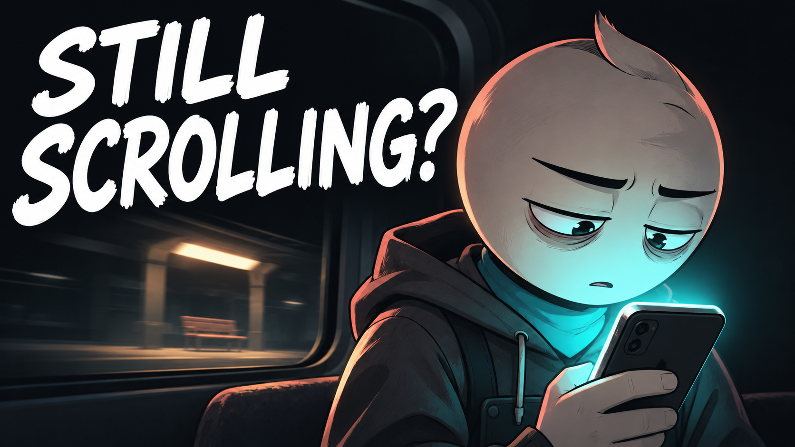
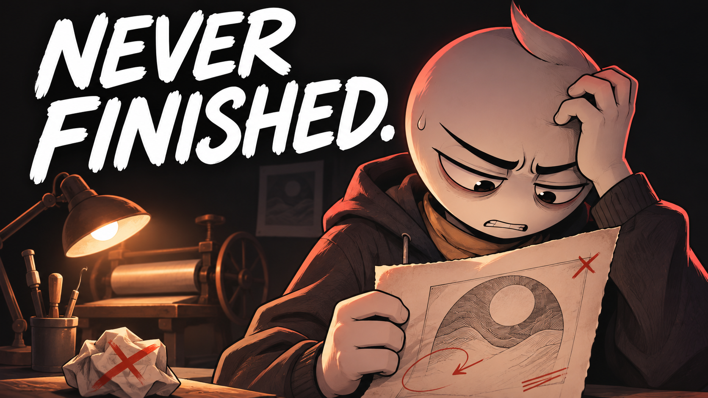
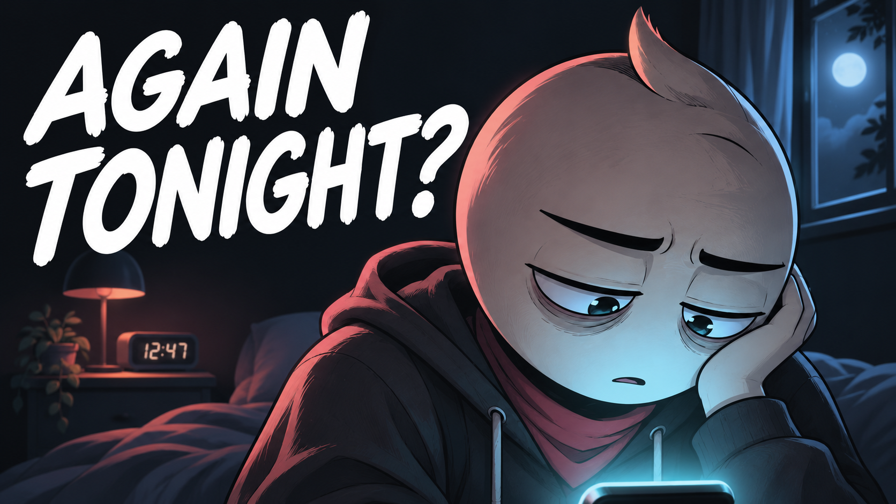
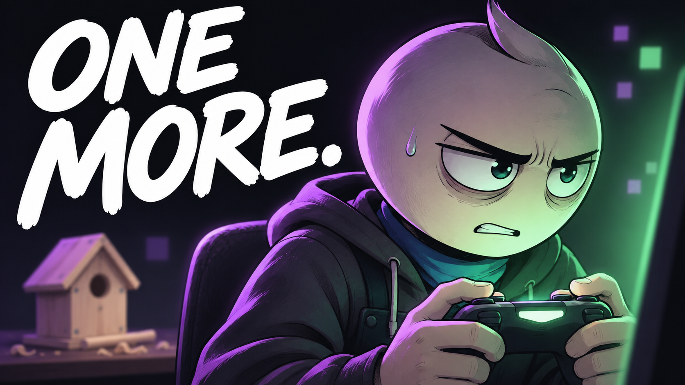
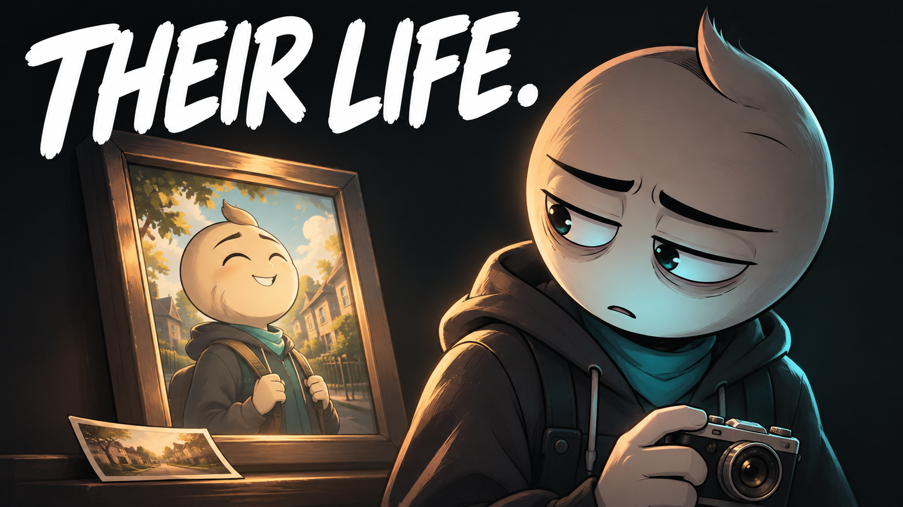
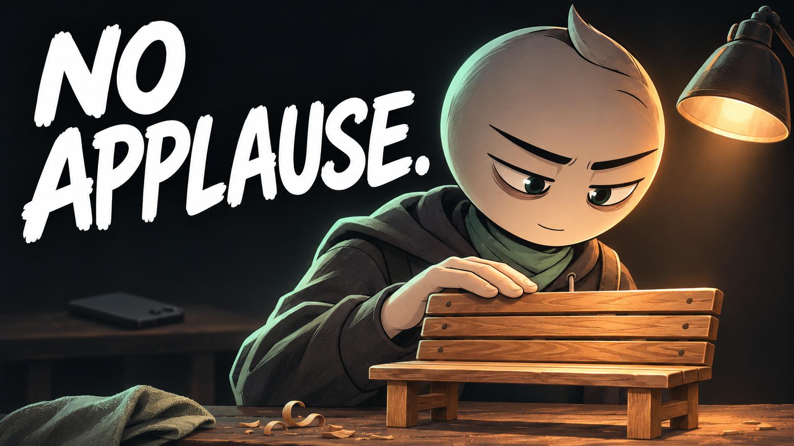
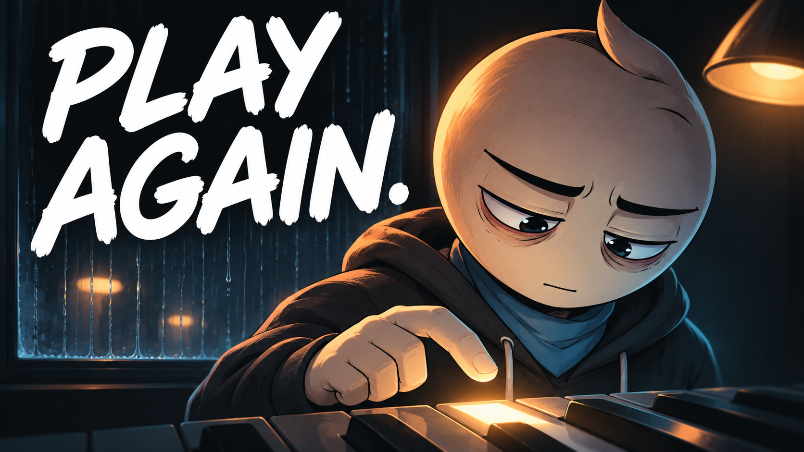
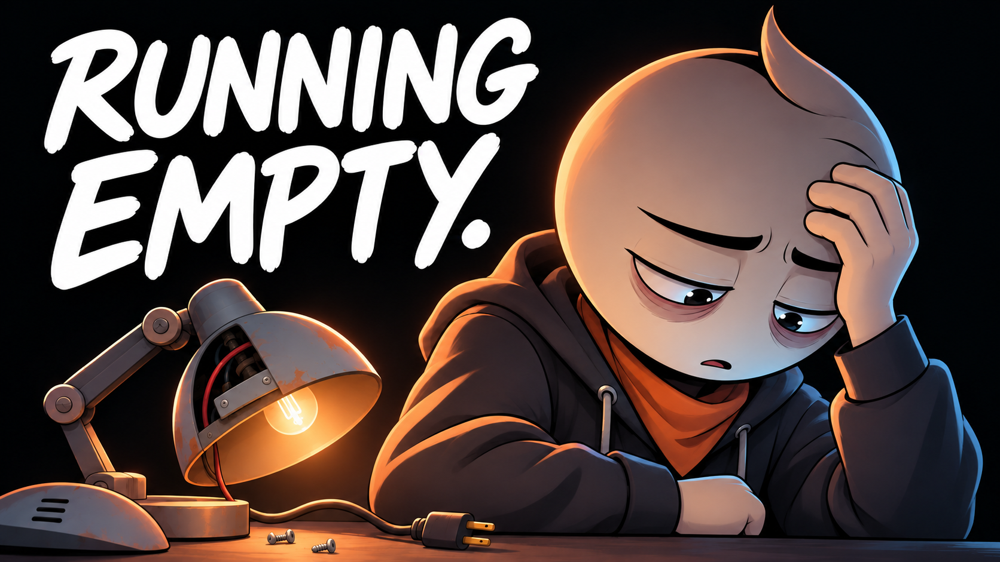
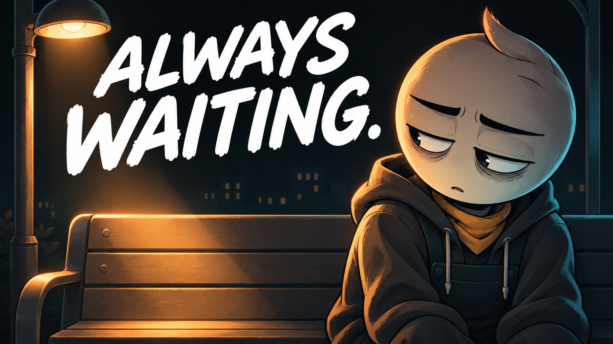
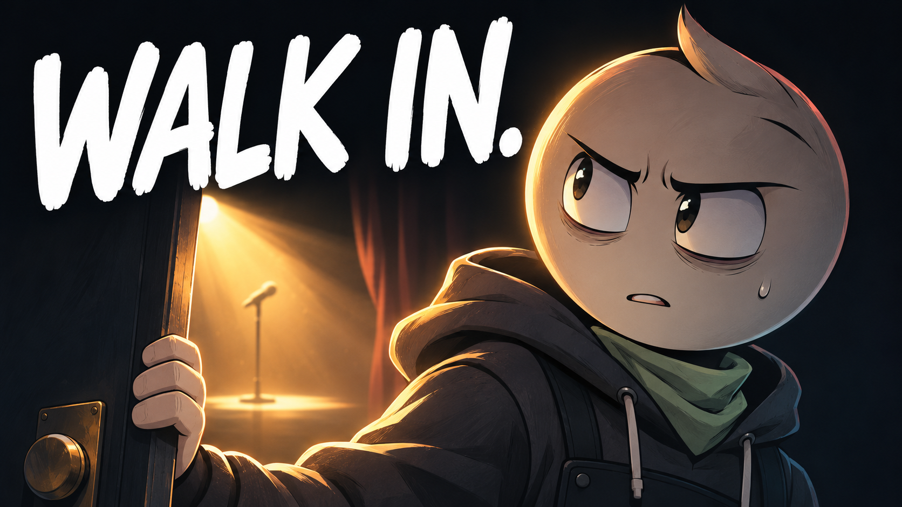

# Títulos, descrições e tags dos 10 vídeos

Todos os textos destinados ao público estão em inglês. As descrições incluem créditos da voz.

# 01 — Your Attention Is Being Sold

## Thumbnail



Texto na capa: **STILL SCROLLING?**

## Título — copiar

```text
Your Attention Is Being Sold | An Animated Short Film
```

## Descrição — copiar

```text
Eli missed his train stop with his phone in his hand. Noticing what else he was missing took longer.

Your Attention Is Being Sold is an original animated short film about phone distraction, endless scrolling, and being present for the people in front of us. A planned evening with a friend becomes a quiet test of how much attention a screen can take — and how deliberately we have to choose where it goes.

Which part of your day would you like to take back?

Subscribe to Hardstart Films for original animated stories about discipline, fear, habits, and becoming better.
https://www.youtube.com/@hardstartfilms

Credits
Original story, illustrations, music and sound design: Hardstart Films.
Synthetic narration: Piper / LibriTTS high.
LibriTTS dataset: Heiga Zen et al. (2019), CC BY 4.0.
https://www.openslr.org/60/
https://creativecommons.org/licenses/by/4.0/

#AnimatedShortFilm #DigitalDistraction #HardstartFilms
```

## Tags — copiar

```text
Your Attention Is Being Sold, phone distraction, digital distraction, endless scrolling, phone habits, screen time, attention economy, being present, digital wellbeing, self improvement animation, personal growth, animated short film, animated story, Hardstart Films
```


---

# 02 — The Draft You Never Finish

## Thumbnail



Texto na capa: **NEVER FINISHED.**

## Título — copiar

```text
The Draft You Never Finish | An Animated Short Film
```

## Descrição — copiar

```text
June can always imagine a better version of the print. Calling one finished is the part she cannot face.

The Draft You Never Finish is an original animated short film about perfectionism, creative doubt, and the fear of letting other people see your work. In a small printmaking studio, each revision promises relief while the unfinished pages keep piling up. The story follows the difficult choice between protecting an imagined perfect result and allowing a real piece of work to leave the desk.

What have you been afraid to call finished?

Subscribe to Hardstart Films for original animated stories about discipline, fear, habits, and becoming better.
https://www.youtube.com/@hardstartfilms

Credits
Original story, illustrations, music and sound design: Hardstart Films.
Synthetic narration: Piper / LibriTTS high.
LibriTTS dataset: Heiga Zen et al. (2019), CC BY 4.0.
https://www.openslr.org/60/
https://creativecommons.org/licenses/by/4.0/

#AnimatedShortFilm #Perfectionism #HardstartFilms
```

## Tags — copiar

```text
The Draft You Never Finish, perfectionism, creative perfectionism, fear of finishing, creative doubt, unfinished projects, finishing creative work, artist story, printmaking, creative confidence, personal growth animation, animated short film, animated story, Hardstart Films
```


---

# 03 — The Promise After Midnight

## Thumbnail



Texto na capa: **AGAIN TONIGHT?**

## Título — copiar

```text
The Promise After Midnight | An Animated Short Film
```

## Descrição — copiar

```text
Every night, the promise sounds convincing. Every night, the screen stays on.

The Promise After Midnight is an original animated short film about late-night scrolling, instant relief, and the loneliness that can hide inside an ordinary routine. A familiar habit keeps offering a way to switch off uncomfortable feelings. A small return to drawing and human connection opens another possibility, one evening at a time.

What would a kinder evening routine look like for you?

Subscribe to Hardstart Films for original animated stories about discipline, fear, habits, and becoming better.
https://www.youtube.com/@hardstartfilms

Credits
Original story, illustrations, music and sound design: Hardstart Films.
Synthetic narration: Piper / LibriTTS high.
LibriTTS dataset: Heiga Zen et al. (2019), CC BY 4.0.
https://www.openslr.org/60/
https://creativecommons.org/licenses/by/4.0/

#AnimatedShortFilm #ChangingHabits #HardstartFilms
```

## Tags — copiar

```text
The Promise After Midnight, late night scrolling, instant gratification, instant relief, nighttime habits, phone habits, loneliness, changing habits, emotional escape, human connection, personal growth, animated short film, animated story, Hardstart Films
```


---

# 04 — One More Game

## Thumbnail



Texto na capa: **ONE MORE.**

## Título — copiar

```text
One More Game | An Animated Short Film
```

## Descrição — copiar

```text
One more match. One more evening. A promise to his brother keeps waiting.

One More Game is an original animated short film about gaming, escapism, and making room for the promises that matter outside the screen. A shared plan to build a birdhouse slowly disappears behind another round. The story explores what happens when enjoyable downtime starts taking the place of the life someone wanted to show up for.

What real-world promise do you want to make room for?

Subscribe to Hardstart Films for original animated stories about discipline, fear, habits, and becoming better.
https://www.youtube.com/@hardstartfilms

Credits
Original story, illustrations, music and sound design: Hardstart Films.
Synthetic narration: Piper / LibriTTS high.
LibriTTS dataset: Heiga Zen et al. (2019), CC BY 4.0.
https://www.openslr.org/60/
https://creativecommons.org/licenses/by/4.0/

#AnimatedShortFilm #GamingHabits #HardstartFilms
```

## Tags — copiar

```text
One More Game, gaming habits, gaming and life balance, one more match, escapism, screen time, keeping promises, family connection, gaming story, changing habits, personal growth animation, animated short film, animated story, Hardstart Films
```


---

# 05 — Someone Else’s Life

## Thumbnail



Texto na capa: **THEIR LIFE.**

## Título — copiar

```text
Someone Else’s Life | An Animated Short Film
```

## Descrição — copiar

```text
He wanted to make something meaningful. Then he started measuring it against everyone else.

Someone Else's Life is an original animated short film about social comparison, creative confidence, and remembering why you started. A photographer sets out to make a book of neighborhood pictures for his grandmother. As other people's polished work becomes the standard, the personal reason behind his own project begins to disappear.

What would you make if someone else's work could not set the standard?

Subscribe to Hardstart Films for original animated stories about discipline, fear, habits, and becoming better.
https://www.youtube.com/@hardstartfilms

Credits
Original story, illustrations, music and sound design: Hardstart Films.
Synthetic narration: Piper / LibriTTS high.
LibriTTS dataset: Heiga Zen et al. (2019), CC BY 4.0.
https://www.openslr.org/60/
https://creativecommons.org/licenses/by/4.0/

#AnimatedShortFilm #SocialComparison #HardstartFilms
```

## Tags — copiar

```text
Someone Else's Life, social comparison, comparison trap, creative confidence, self worth, photography story, personal projects, finding your own path, creative purpose, personal growth, self improvement animation, animated short film, animated story, Hardstart Films
```


---

# 06 — Nobody Needs to Know

## Thumbnail



Texto na capa: **NO APPLAUSE.**

## Título — copiar

```text
Nobody Needs to Know | An Animated Short Film
```

## Descrição — copiar

```text
Talking about the project was easier than fixing the bench.

Nobody Needs to Know is an original animated short film about consistency, learning a craft, and the difference between announcing progress and making it. An apprentice wants to build something useful for his mother. In the workshop, patient practice and honest feedback slowly become more valuable than the reaction he hoped to get from showing the plan.

What are you building before you talk about it?

Subscribe to Hardstart Films for original animated stories about discipline, fear, habits, and becoming better.
https://www.youtube.com/@hardstartfilms

Credits
Original story, illustrations, music and sound design: Hardstart Films.
Synthetic narration: Piper / LibriTTS high.
LibriTTS dataset: Heiga Zen et al. (2019), CC BY 4.0.
https://www.openslr.org/60/
https://creativecommons.org/licenses/by/4.0/

#AnimatedShortFilm #Consistency #HardstartFilms
```

## Tags — copiar

```text
Nobody Needs to Know, consistency, work in silence, external validation, learning a skill, deliberate practice, honest feedback, woodworking story, keeping promises, personal growth, discipline animation, animated short film, animated story, Hardstart Films
```


---

# 07 — The Day After You Quit

## Thumbnail



Texto na capa: **PLAY AGAIN.**

## Título — copiar

```text
The Day After You Quit | An Animated Short Film
```

## Descrição — copiar

```text
The piano had become a shelf. One difficult night had become the reason to stay away.

The Day After You Quit is an original animated short film about returning after failure, rebuilding trust in yourself, and practicing without demanding a perfect comeback. A pianist still remembers the moment a performance went wrong. Rain, a closed piano lid, and an unfinished piece become the setting for a smaller, more honest return.

What would returning look like for you?

Subscribe to Hardstart Films for original animated stories about discipline, fear, habits, and becoming better.
https://www.youtube.com/@hardstartfilms

Credits
Original story, illustrations, music and sound design: Hardstart Films.
Synthetic narration: Piper / LibriTTS high.
LibriTTS dataset: Heiga Zen et al. (2019), CC BY 4.0.
https://www.openslr.org/60/
https://creativecommons.org/licenses/by/4.0/

#AnimatedShortFilm #StartingOver #HardstartFilms
```

## Tags — copiar

```text
The Day After You Quit, starting over, returning after failure, fear of failure, piano story, music practice, resilience, trying again, imperfect progress, rebuilding confidence, personal growth animation, animated short film, animated story, Hardstart Films
```


---

# 08 — You Can’t Outwork Empty

## Thumbnail



Texto na capa: **RUNNING EMPTY.**

## Título — copiar

```text
You Can’t Outwork Empty | An Animated Short Film
```

## Descrição — copiar

```text
He kept repairing lamps while ignoring his own exhaustion.

You Can't Outwork Empty is an original animated short film about burnout, the guilt of resting, and learning to recognize a limit. In a repair workshop, another task always seems more urgent than stopping. The story follows an exhausted worker as he begins to change the load he is carrying and accept support instead of treating every warning as a reason to push harder.

What would a realistic limit look like this week?

Subscribe to Hardstart Films for original animated stories about discipline, fear, habits, and becoming better.
https://www.youtube.com/@hardstartfilms

Credits
Original story, illustrations, music and sound design: Hardstart Films.
Synthetic narration: Piper / LibriTTS high.
LibriTTS dataset: Heiga Zen et al. (2019), CC BY 4.0.
https://www.openslr.org/60/
https://creativecommons.org/licenses/by/4.0/

#AnimatedShortFilm #Burnout #HardstartFilms
```

## Tags — copiar

```text
You Can't Outwork Empty, burnout story, exhaustion, rest guilt, work life balance, setting boundaries, asking for help, sustainable work, overwork, self care, personal growth, animated short film, animated story, Hardstart Films
```


---

# 09 — The Empty Seat

## Thumbnail



Texto na capa: **ALWAYS WAITING.**

## Título — copiar

```text
The Empty Seat | An Animated Short Film
```

## Descrição — copiar

```text
He kept hoping someone would sit beside him. Reaching out felt harder than waiting.

The Empty Seat is an original animated short film about everyday loneliness, small acts of courage, and the slow work of building a connection. A familiar bus stop becomes a picture of everything left unsaid. Through an ordinary community workshop, the story explores how belonging can begin with initiative, patience, and showing up for other people too.

What is one small way you could reach out today?

Subscribe to Hardstart Films for original animated stories about discipline, fear, habits, and becoming better.
https://www.youtube.com/@hardstartfilms

Credits
Original story, illustrations, music and sound design: Hardstart Films.
Synthetic narration: Piper / LibriTTS high.
LibriTTS dataset: Heiga Zen et al. (2019), CC BY 4.0.
https://www.openslr.org/60/
https://creativecommons.org/licenses/by/4.0/

#AnimatedShortFilm #HumanConnection #HardstartFilms
```

## Tags — copiar

```text
The Empty Seat, loneliness, making friends, human connection, belonging, community, reaching out, everyday courage, social connection, friendship story, personal growth animation, animated short film, animated story, Hardstart Films
```


---

# 10 — The Door You Keep Avoiding

## Thumbnail



Texto na capa: **WALK IN.**

## Título — copiar

```text
The Door You Keep Avoiding | An Animated Short Film
```

## Descrição — copiar

```text
The hardest part of the performance happened before he reached the stage.

The Door You Keep Avoiding is an original animated short film about fear of judgment, stage fright, and letting people see something you have made. Outside a small performance space, a first-time performer has plenty of reasons to turn around. One open doorway holds the possibility of a mistake, an audience, and an experience he cannot get by remaining in the corridor.

What door have you been standing outside?

Subscribe to Hardstart Films for original animated stories about discipline, fear, habits, and becoming better.
https://www.youtube.com/@hardstartfilms

Credits
Original story, illustrations, music and sound design: Hardstart Films.
Synthetic narration: Piper / LibriTTS high.
LibriTTS dataset: Heiga Zen et al. (2019), CC BY 4.0.
https://www.openslr.org/60/
https://creativecommons.org/licenses/by/4.0/

#AnimatedShortFilm #CreativeCourage #HardstartFilms
```

## Tags — copiar

```text
The Door You Keep Avoiding, fear of judgment, stage fright, first performance, creative courage, self doubt, sharing your work, taking the first step, fear of failure, personal growth animation, animated short film, animated story, Hardstart Films
```
